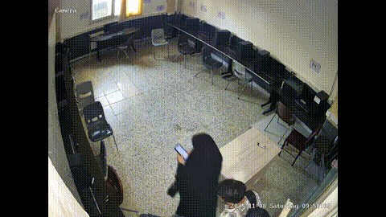

<div align="center">

**🌐 [English](README.md) | [Persian](README.fa.md)**

# 📱 MUPHIVA-19: Meybod University Phone-use Human Interaction Video Analytics



</div>

---

## 📖 معرفی

**MUPHIVA-19** (مجموعه‌داده تحلیل تعامل انسانی و استفاده از تلفن همراه دانشگاه میبد) یک مجموعه‌داده ویدیویی استاندارد است که برای پیشبرد تحقیقات در زمینه تشخیص استفاده از تلفن همراه در محیط‌های نظارتی داخلی طراحی شده است. این مجموعه شامل **۱۹ موقعیت مکانی متمایز** است و یک بنچمارک چالش‌برانگیز برای مدل‌های یادگیری عمیق فراهم می‌کند.

### 🔑 ویژگی‌های کلیدی:
- **پوشش چندمکانه:** ۱۷۱ ویدیو در ۱۹ موقعیت داخلی و نیمه‌باز (آزمایشگاه‌ها، راهروها، پارکینگ‌ها و...).
- **شرایط متنوع:** رزولوشن‌های متفاوت (۱۲۸۰×۸۰۰ تا ۳۰۷۲×۲۰۴۸)، نرخ فریم (۱۲٫۵ تا ۳۰ فریم بر ثانیه) و شرایط نوری مختلف.
- **فرمت استاندارد:** تمام ویدیوها همراه با برچسب‌های فریم‌به‌فریم برای ردیابی افراد و وضعیت استفاده از تلفن همراه.
- **سناریوهای واقعی:** ثبت رفتارهای طبیعی و بدون‌نقشه، مناسب برای کاربردهای نظارتی واقعی.

---

## 📂 ساختار مخزن

```text
.
├── README.md
├── README.fa.md
├── requirements.txt
├── .gitignore
├── src/                          # کدهای اصلی پروژه
│   ├── build_clips.py            # ساخت کش کلیپ‌های برش‌خورده
│   ├── dataset.py                # کد پایه‌ی دیتاست
│   ├── dataset_stp.py            # دیتاست / بارگذاری داده
│   ├── models_v3.py              # تعریف مدل‌ها
│   ├── models_multimodal.py      # اجزای مدل چندوجهی
│   ├── eval_tools.py             # ابزارهای ارزیابی
│   ├── train_v3.py               # اسکریپت آموزش
│   └── viz/
│       ├── config.py             # مسیرها و ثابت‌ها
│       ├── e2e_core.py           # برش، اتصال ترک‌ها، فیلتر زمانی
│       └── e2e.py                # خط فرمان: run / eval
├── samples/
│   ├── videos/                   # نمونه‌ویدئوها
│   └── annotations/              # فایل‌های برچسب متناظر
├── runs_final/
│   └── A_final_f0_s0/            # مدل منتشرشده
└── weights/
    └── A_final_args.json         # آرگومان‌های آموزش
```

---

## 📊 داده

دیتاست کامل شامل **۱۷۱ ویدیو** است که در **۱۹ موقعیت مکانی** ضبط شده‌اند. رزولوشن ویدئوها از **۱۲۸۰×۸۰۰ تا ۳۰۷۲×۲۰۴۸** و نرخ فریم از حدود **۱۲٫۵ تا ۳۰ فریم بر ثانیه** متغیر است.

در این مخزن فقط چند ویدئوی نمونه از **۶ موقعیت از ۱۹ موقعیت**، همراه با فایل‌های برچسب قرار دارد.

<div align="center">

| موقعیت مکانی |
|:---:|
| Laboratory Corridor |
| Logic Circuit Lab |
| Microprocessor Laboratory |
| Polymer Laboratory |
| Faculty Parking |
| Physics Laboratory |

</div>

نمونه‌ویدئوها برای اجرای دمو کافی هستند. آموزش و ارزیابی نیازمند دیتاست کامل است.

### 📥 نحوه‌ی درخواست

برای دریافت دیتاست کامل با رزولوشن بالا، لطفاً به نویسنده‌ی مسئول ایمیل بزنید:

- **تماس:** Dr. Mohsen Sardari Zarchi
- **ایمیل:** [sardarimohsen@gmail.com](mailto:sardarimohsen@gmail.com)
- **موضوع ایمیل:** `MUPHIVA-19 High-Resolution Data Request`

---

## 🧠 مدل

در این مرحله فقط مدل اولیه منتشر شده است: مدل **A** با بک‌بون **DINOv2 ViT-S/14** (تنظیم‌شده با LoRA) و یک هد زمانی ساده.

---

## ⚙️ نصب

```bash
git clone https://github.com/sardarimohsen/MobilePhone-Usage-Detection-Video-Dataset.git
cd MobilePhone-Usage-Detection-Video-Dataset
python -m venv .venv && source .venv/bin/activate
pip install -r requirements.txt
```

---

## 🚀 نحوه‌ی استفاده

> **توجه:** اجرای دمو روی یک نمونه‌ویدئو فقط به فایل‌های موجود در این مخزن نیاز دارد. اما ساخت کش برش‌ها، آموزش مدل و ارزیابی خط لوله‌ی کامل نیازمند دسترسی به دیتاست کامل است.

### 🎬 اجرای دمو روی یک نمونه‌ویدئو

```bash
python -m src.viz.e2e run \
  --video "samples/videos/<location>/<video>.mp4" \
  --out output/demo.mp4 \
  --run A --ckpts 0:0 \
  --person-model yolo11n.pt
```

ویدئوی خروجی برای هر شخص ردیابی‌شده یک کادر رنگی نشان می‌دهد (🟢 در حال استفاده / 🔴 عدم استفاده).

### 🗂️ ساخت کش برش‌ها

```bash
python src/build_clips.py --dataset-root <DATASET_ROOT> --ann-root <ANNOTATION_ROOT> \
  --split-map <SPLIT_MAP> --out <CACHE> --size 224
```

### 🏋️ آموزش

```bash
python src/train_v3.py --cache <CACHE> --folds <FOLDS_JSON> --fold 0 --seed 0 \
  --out runs_final --tag A_final --head simple \
  --backbone vit_small_patch14_dinov2.lvd142m --size 224 \
  --lora-r 16 --lora-alpha 32 --lora-target "qkv,proj" \
  --d-model 256 --layers 2 --heads 4
```

### 📈 ارزیابی خط لوله‌ی کامل

```bash
python -m src.viz.e2e eval --run A --fold 0 --seed 0 --modes det gt \
  --out output/e2e_eval --person-model yolo11n.pt
```

---

## 🔄 خط لوله‌ی پردازش

۱. **تشخیص و ردیابی افراد** (ردیاب Ultralytics).
۲. **اتصال دوباره‌ی ترک‌ها** برای کاهش تغییر شناسه.
۳. **برش مربعی ماسک‌شده** اطراف هر شخص.
۴. **طبقه‌بندی در سطح کلیپ** با مدل `A`.
۵. **فیلتر زمانی** برای تعیین وضعیت نهایی هر شخص.
