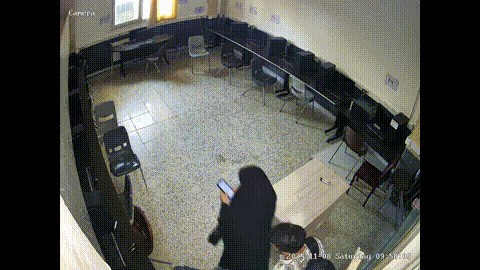

<div align="center">

**🌐 [English](README.md) | [Persian](README.fa.md)**

# 📱 MUPHIVA-19: Meybod University Phone-use Human Interaction Video Analytics



</div>

---

## 📖 Overview

**MUPHIVA-19** (Meybod University Phone-use Human Interaction Video Analytics) is a standardized video dataset designed to advance research in mobile-phone usage detection within indoor surveillance environments. The dataset captures real-world scenarios across **19 distinct locations**, providing a challenging benchmark for deep learning models.

### 🔑 Key Features:
- **Multi-Location Coverage:** 171 videos recorded across 19 different indoor and semi-outdoor locations (e.g., laboratories, corridors, parking areas).
- **Diverse Conditions:** Varying resolutions (1280×800 to 3072×2048), frame rates (12.5 to 30 fps), and lighting conditions.
- **Standardized Format:** All videos are accompanied by frame-level annotations for person tracking and phone-usage states.
- **Real-World Scenarios:** Captures natural, unscripted behaviors, making it suitable for practical surveillance applications.

---

## 📂 Repository Structure

```text
.
├── README.md
├── README.fa.md
├── requirements.txt
├── .gitignore
├── src/                          # Main source code
│   ├── build_clips.py            # Builds cropped-clip cache
│   ├── dataset.py                # Base dataset code
│   ├── dataset_stp.py            # Dataset / data loading
│   ├── models_v3.py              # Model definitions
│   ├── models_multimodal.py      # Multimodal components
│   ├── eval_tools.py             # Evaluation utilities
│   ├── train_v3.py               # Training script
│   └── viz/
│       ├── config.py             # Paths and constants
│       ├── e2e_core.py           # Crop, tracker stitching, temporal filter
│       └── e2e.py                # CLI: run / eval
├── samples/
│   ├── videos/                   # Sample videos
│   └── annotations/              # Matching annotation files
├── runs_final/
│   └── A_final_f0_s0/            # Released model (head.pt, deploy.json)
└── weights/
    └── A_final_args.json         # Training arguments
```

---

## 📊 Data

The full dataset contains **171 videos** recorded at **19 locations**. Video resolutions range from **1280×800 to 3072×2048** and frame rates from about **12.5 to 30 fps** (most videos are 25 fps).

This repository includes a few sample videos (one or two per location) from **6 of the 19 locations**, each with its annotation files.

<div align="center">

| Location |
|:---:|
| Laboratory Corridor |
| Logic Circuit Lab |
| Microprocessor Laboratory |
| Polymer Laboratory |
| Faculty Parking |
| Physics Laboratory |

</div>

The sample videos are sufficient to run the demo (`src.viz.e2e run`). Training and `eval` require the full dataset, which is not included in this repository.

### 📥 How to Request

To request the full-resolution dataset, please send an email to the corresponding author:

- **Contact:** Dr. Mohsen Sardari Zarchi
- **Email:** [sardarimohsen@gmail.com](mailto:sardarimohsen@gmail.com)
- **Subject Line:** `MUPHIVA-19 High-Resolution Data Request`

---

## 🧠 Model

Only the initial model is released at this stage: model **A**, a **DINOv2 ViT-S/14** backbone (fine-tuned with LoRA) with a simple temporal head. It is stored in `runs_final/A_final_f0_s0/`. Its full training arguments are in `weights/A_final_args.json`.

The person detector `yolo11n.pt` is downloaded automatically by Ultralytics on first use.

---

## ⚙️ Installation

```bash
git clone https://github.com/sardarimohsen/MobilePhone-Usage-Detection-Video-Dataset.git
cd MobilePhone-Usage-Detection-Video-Dataset
python -m venv .venv && source .venv/bin/activate
pip install -r requirements.txt
```

For anything that reads the full dataset or the crop cache, set the paths in `src/viz/config.py`, or the environment variables `PHONE_VAULT` (data and cache) and `PHONE_RUNS` (run folders).

---

## 🚀 Usage

> **Note:** Running the demo on a sample video requires only the files provided in this repository. However, building the crop cache, training the model, and evaluating the full pipeline require access to the complete dataset.

### 🎬 Run the Demo on a Sample Video

```bash
python -m src.viz.e2e run \
  --video "samples/videos/<location>/<video>.mp4" \
  --out output/demo.mp4 \
  --run A --ckpts 0:0 \
  --person-model yolo11n.pt
```

The output video shows a color-coded box per tracked person (🟢 using / 🔴 not using).

### 🗂️ Build the Crop Cache

```bash
python src/build_clips.py --dataset-root <DATASET_ROOT> --ann-root <ANNOTATION_ROOT> \
  --split-map <SPLIT_MAP> --out <CACHE> --size 224
# Crop options (--margin, --mask-outside, --top-frac, ...): see --help
```

### 🏋️ Train

```bash
python src/train_v3.py --cache <CACHE> --folds <FOLDS_JSON> --fold 0 --seed 0 \
  --out runs_final --tag A_final --head simple \
  --backbone vit_small_patch14_dinov2.lvd142m --size 224 \
  --lora-r 16 --lora-alpha 32 --lora-target "qkv,proj" \
  --d-model 256 --layers 2 --heads 4
# Remaining hyper-parameters: weights/A_final_args.json
```

### 📈 Evaluate the Full Pipeline

```bash
python -m src.viz.e2e eval --run A --fold 0 --seed 0 --modes det gt \
  --out output/e2e_eval --person-model yolo11n.pt
```

---

## 🔄 Pipeline

1. **Person detection and tracking** (Ultralytics tracker, with optional re-identification).
2. **Track stitching** to reduce identity switches (IoU, spatial distance and time gap).
3. **Masked square crop** around each person.
4. **Clip-level classification** with model `A`.
5. **Temporal filter** (exponential moving average with on/off hysteresis) producing the final per-person state.
